# MoneyNote: 개인 가계부 관리 프로그램 (Checkpoint 3: Detail Design)

**김동욱, 220057**
Dept. Artificial Intelligence
Chonnam National University
Gwangju

<!--
작성 규칙 (tools/fill_report_cp3.ps1 이 이 파일을 읽어 양식 사본에 채운다)
- 양식 ssd_ip_checkpoint3_report_format.doc 의 섹션 8개를 같은 순서와 이름으로 쓴다.
  애플리케이션 이름은 양식처럼 제목 칸에만 쓴다.
- 목록은 양식의 bullet list 를 쓴다. "> " 로 시작하는 줄은 양식의 ": This function do something.."
  줄과 같은 형식(글머리 기호 없는 들여쓴 줄)이 된다. 표는 쓰지 않는다.
- 그림은 양식처럼 단 폭으로 넣고 캡션은 양식의 figure caption 스타일(Fig. N.)을 쓴다.
- 유스케이스 다이어그램은 연관(association)까지만 그린다. include/extend 같은 의존 관계는 넣지 않는다.
-->

## A Topic out of 5 selections

다음 다섯 주제 중 4번을 선택했다.

1. Library Loan Management System
2. Personal Schedule Management Program
3. Student Grade Management System
4. Household Account Book Program (선택)
5. Simple Game Program

대상 애플리케이션은 **MoneyNote**, 단일 사용자용 오프라인 데스크톱 가계부(Java Swing)다. 가계부 데이터는 날짜, 금액, 분류를 갖는 시계열 거래다. 거래는 계속 쌓이고 기간별·분류별 합산과 비율 계산이 반드시 뒤따르므로, 표 조회, 폼 검증, 파일 저장이라는 기본기 위에 집계, 시각화, 규칙 기반 경고를 얹을 수 있다.

## Characteristics

MoneyNote 는 수입과 지출을 기록하고, 기간과 분류별로 집계하고, 예산을 넘으면 경고하는 프로그램이다. 특징은 다음과 같다.

- C1 단일 사용자 오프라인 데스크톱: 네트워크, 로그인, 서버가 없고 실행 즉시 사용한다.
- C2 시계열 누적 데이터: 날짜가 1차 정렬 키이고, 조회는 항상 기간을 전제로 한다.
- C3 파생 계산 중심: 월 합계, 잔액, 분류별 비중처럼 화면의 숫자 대부분이 계산 결과다.
- C4 금액 데이터 무결성: 금액은 원 단위 정수(long)로 다루고 음수와 비숫자는 입력 단계에서 막는다.
- C5 규칙 기반 능동 피드백: 예산 사용률을 스스로 판정해 경고하고, 고정 지출을 스스로 만든다.
- C6 시각화: 분류별 지출 비중을 막대그래프로 보여준다.
- C7 3계층 객체 구조: 화면(ui), 응용 로직(service), 저장소(repository)를 나누고 화면은 저장소를 직접 부르지 않는다. 검증 규칙이 서비스 한곳에 모여 등록 화면과 고정 지출 자동 생성이 같은 규칙을 따른다.
- C8 변경 즉시 갱신: 거래가 바뀌면 거래내역 화면이 통계·예산 화면에 알리고, 두 화면은 저장된 합계가 아니라 현재 거래로 다시 계산한다.

이전 체크포인트와 비교하면, C1~C6 은 체크포인트 1·2 에서 정한 특징을 그대로 잇고 C7, C8 은 이번 상세 설계에서 객체 구조를 정하며 새로 드러난 특징이다. 체크포인트 2 의 기능 단위 유스케이스 5개는 목표가 하나뿐인 유스케이스 15개로 나뉘었고, 체크포인트 2 에서 비기능 요구사항으로만 두었던 저장과 불러오기는 사용자가 겪는 시작·종료 유스케이스(UC14, UC15)가 되었다. 또 문장으로만 쓴 흐름을 이번에는 시퀀스 다이어그램, 화면 설계, 함수 명세로 구체화했다.

## Requirement Lists

사용자는 월급을 받아 생활비를 직접 관리하는 대학생이다. 은행 앱에 남지 않는 현금 지출까지 한곳에 모으고, 이번 달에 어디에 얼마를 썼는지, 예산을 넘었는지를 계정 없이 바로 확인하고 싶어 한다. 이 사용자가 바라는 것을 요구사항으로 정리했다. 괄호 안은 해당 유스케이스다.

- FR1 날짜, 유형(수입/지출), 금액, 분류, 결제수단, 메모를 입력해 거래를 등록할 수 있어야 한다. (UC1)
- FR2 금액이 비었거나 숫자가 아니거나 0 이하이면, 또는 분류를 고르지 않으면 저장을 거부해야 한다. 미래 날짜는 확인을 받아야 한다. (UC1, UC2)
- FR3 목록에서 고른 거래를 수정하거나, 확인을 거쳐 삭제할 수 있어야 한다. (UC2, UC3)
- FR4 거래 목록은 날짜 내림차순 표로 보이고, 컬럼 헤더를 눌러 다시 정렬할 수 있어야 한다. (UC4)
- FR5 기간, 유형, 분류, 메모 키워드를 AND 조건으로 걸러 조회하고 결과의 건수와 합계를 보여야 하며, 이번 달·지난 달·올해 버튼을 제공해야 한다. (UC4)
- FR6 분류를 추가할 수 있어야 하고, 최초 실행 시 기본 분류 11개가 있어야 한다. (UC5)
- FR7 분류 이름을 바꿀 수 있어야 하며, 같은 유형 안에서 이름이 겹치면 거부해야 한다. (UC5, UC6)
- FR8 거래가 쓰고 있는 분류는 삭제를 막고 사용 건수를 알려야 한다. (UC7)
- FR9 선택한 월의 총수입, 총지출, 잔액과 전월 대비 지출 증감률을 보여야 한다. (UC8)
- FR10 선택한 월의 지출을 분류별로 합산해 비중과 함께 막대그래프로 보이고, 가장 큰 분류를 강조해야 한다. (UC9)
- FR11 분류별 월 예산 한도를 정할 수 있어야 한다. (UC10)
- FR12 사용률 80% 미만은 정상, 80~100%는 주의, 100% 이상은 초과로 색을 달리해 보이고, 초과면 초과 금액을 보여야 한다. (UC11)
- FR13 고정 지출 규칙(분류, 금액, 매월 결제일, 메모)을 추가, 비활성화, 삭제할 수 있어야 한다. (UC12)
- FR14 프로그램 시작 시 활성 규칙마다 이번 달 거래를 한 번만 만들고, 사용자가 지운 자동 거래를 되살리지 않아야 한다. (UC13)
- FR15 시작할 때 데이터를 불러오고, 종료할 때 모든 변경을 저장해야 한다. (UC14, UC15)
- NFR1 네트워크나 계정 없이 단일 사용자 데스크톱에서 동작해야 한다.
- NFR2 모든 데이터는 data 폴더에 UTF-8 CSV로 저장되어 엑셀에서 열 수 있어야 한다.
- NFR3 금액은 원 단위 정수(long)로 저장하고 계산해 오차가 없어야 한다.
- NFR4 저장에 실패하면 경고하고 종료를 보류해야 하며, 손상된 행은 건너뛰고 알려야 한다.
- NFR5 거래가 바뀌면 요약, 통계, 예산 화면이 즉시 다시 계산되어야 한다.

## Usecases

액터는 사용자(가계부를 쓰는 개인)와 파일 시스템(data 폴더의 CSV 파일) 둘이다. 유스케이스마다 목표는 하나다.

- UC1 거래 등록: 새 수입이나 지출을 기록한다. (사용자 / FR1, FR2)
> 사전 조건: 거래내역 탭이 열려 있고 분류가 하나 이상 있다.
> 기본 흐름: 1) 등록 버튼을 누른다. 2) 날짜가 오늘로 채워진 입력 창이 열린다. 3) 유형을 고르면 그 유형의 분류만 보인다. 4) 금액, 분류, 결제수단, 메모를 입력하고 저장한다. 5) 시스템이 검증 후 새 id로 저장한다. 6) 목록, 통계, 예산 화면을 다시 계산한다.
> 예외 흐름: 금액이 비었거나 숫자가 아니거나 0 이하이면 입력 확인 메시지를 보이고 4)로 돌아간다. 분류가 없으면 "분류를 선택하세요."를 보인다. 미래 날짜는 등록 여부를 묻는다. 취소하면 저장하지 않는다.
> 사후 조건: 거래가 하나 늘고 요약·통계·예산 값이 갱신된다.
- UC2 거래 수정: 잘못 입력한 거래를 고친다. (사용자 / FR2, FR3)
> 기본 흐름: 1) 목록에서 거래를 고르고 수정을 누른다. 2) 기존 값이 채워진 입력 창이 열린다. 3) 값을 바꾸고 저장한다. 4) UC1과 같은 규칙으로 검증하고 같은 id의 거래를 바꾼다.
> 예외 흐름: 거래를 고르지 않으면 "먼저 목록에서 거래를 선택하세요."를 보인다. 검증 실패는 UC1과 같다.
> 사후 조건: id는 그대로이고 나머지 값이 바뀐다.
- UC3 거래 삭제: 필요 없는 거래를 지운다. (사용자 / FR3)
> 기본 흐름: 1) 거래를 고르고 삭제를 누른다. 2) "이 거래를 삭제하시겠습니까?"에 예를 누른다. 3) 거래를 지우고 화면을 다시 계산한다.
> 예외 흐름: 거래를 고르지 않았거나 아니오를 누르면 아무것도 바꾸지 않는다.
> 사후 조건: 자동 생성 거래였다면 같은 달에 다시 만들어지지 않는다.
- UC4 거래 조회 및 검색: 조건에 맞는 거래와 그 합계를 본다. (사용자 / FR4, FR5)
> 기본 흐름: 1) 거래내역 탭에 이번 달 거래가 날짜 내림차순으로 보인다. 2) 기간, 유형, 분류, 메모 키워드를 입력하고 조회한다. 3) 조건을 모두 만족하는 거래와 건수, 수입, 지출, 잔액이 보인다.
> 대안 흐름: 이번 달·지난 달·올해 버튼은 기간을 채워 바로 조회한다. 컬럼 헤더를 누르면 다시 정렬한다.
> 예외 흐름: 시작일이 종료일보다 늦으면 알리고 두 값을 바꿔 조회한다. 0건이면 "조건에 맞는 거래가 없습니다."를 보인다.
- UC5 분류 추가: 새 분류를 만든다. (사용자 / FR6, FR7)
> 기본 흐름: 1) 분류 관리 창에서 이름과 유형을 입력하고 추가를 누른다. 2) 같은 유형의 이름 중복을 검사하고 분류를 만든다. 3) 입력 창과 예산 화면의 분류 목록이 갱신된다.
> 예외 흐름: 이름이 비었거나 중복이면 거부한다.
- UC6 분류 이름 변경: 분류 이름을 바꾼다. (사용자 / FR7)
> 기본 흐름: 1) 분류를 고르고 새 이름을 입력한 뒤 이름 변경을 누른다. 2) 중복을 검사하고 이름을 바꾼다. 3) 거래는 분류 id를 참조하므로 기존 거래에도 새 이름이 보인다.
> 예외 흐름: 이름이 비었거나 중복이면 거부한다.
- UC7 분류 삭제: 쓰지 않는 분류를 지운다. (사용자 / FR8)
> 기본 흐름: 1) 분류를 고르고 삭제를 누른 뒤 확인한다. 2) 이 분류를 쓰는 거래 수를 센다. 3) 0건이면 분류를 지우고 목록을 갱신한다.
> 예외 흐름: N건이 있으면 "이 분류를 사용하는 거래가 N건 있습니다. 먼저 정리하세요."를 보이고 지우지 않는다.
- UC8 월별 수지 요약 조회: 한 달의 수입, 지출, 잔액과 전월 대비 증감을 본다. (사용자 / FR9)
> 기본 흐름: 1) 통계 탭을 연다. 2) 조회 월이 이번 달로 채워진다. 3) 총수입, 총지출, 잔액과 전월 대비 지출 증감률이 보인다.
> 예외 흐름: 조회 월 형식이 틀리면 "조회 월은 yyyy-MM 형식으로 입력하세요."를 보인다. 전월 거래가 없으면 "비교 데이터 없음"을 보인다.
- UC9 분류별 지출 통계 조회: 어느 분류에 얼마를 썼는지 그래프로 본다. (사용자 / FR10)
> 기본 흐름: 1) 조회 월의 지출을 분류별로 합산한다. 2) 비중과 함께 금액 내림차순 표로 보인다. 3) 막대그래프를 그리고 가장 큰 분류를 빨간색으로 강조한다.
> 예외 흐름: 지출이 없으면 "표시할 지출 내역이 없습니다."를 그린다. 분류가 8개를 넘으면 나머지를 기타로 묶는다.
- UC10 예산 한도 설정: 분류별 월 한도를 정한다. (사용자 / FR11)
> 기본 흐름: 1) 예산 탭에서 조회 월, 분류, 한도를 입력하고 예산 설정을 누른다. 2) 한도를 검증하고 저장한다. 같은 분류·같은 달이면 한도만 바꾼다. 3) 예산 현황을 다시 보인다.
> 예외 흐름: 분류를 고르지 않았거나 한도가 0 이하이면 거부한다.
- UC11 예산 사용 현황 확인: 한도 대비 사용률과 경고 단계를 본다. (사용자 / FR12)
> 기본 흐름: 1) 지출 분류마다 사용액과 한도를 구한다. 2) 사용률로 정상(초록), 주의(노랑), 초과(빨강)를 판정해 보이고, 초과면 초과 금액도 보인다.
> 예외 흐름: 예산이 없는 분류는 미설정(회색)으로 보인다.
- UC12 고정 지출 규칙 관리: 매달 나가는 지출을 규칙으로 등록하거나 끈다. (사용자 / FR13)
> 기본 흐름: 1) 고정 지출 창에서 분류, 금액, 결제일(1~31), 메모를 입력하고 규칙 추가를 누른다. 2) 검증 후 규칙을 저장한다.
> 대안 흐름: 규칙의 활성을 끄면 다음 달부터 만들지 않는다. 규칙을 삭제해도 이미 만든 거래는 남는다.
> 예외 흐름: 금액이 0 이하이거나 결제일이 1~31 밖이면 거부한다.
- UC13 고정 지출 자동 생성: 이번 달 고정 지출을 거래로 만든다. (사용자가 프로그램을 실행할 때 / FR14)
> 기본 흐름: 1) 활성 규칙 중 이번 달 생성 기록이 없는 것을 고른다. 2) 결제일로 날짜를 정하고 UC1과 같은 검증으로 지출 거래를 만든다. 3) 생성 기록을 남기고 만든 건수를 알린다.
> 예외 흐름: 그 달에 없는 결제일(예: 2월 31일)은 말일로 만든다. 사용자가 지운 자동 거래는 생성 기록이 있으므로 다시 만들지 않는다.
- UC14 데이터 불러오기: 시작할 때 저장된 데이터를 읽는다. (사용자, 파일 시스템 / FR15, NFR4)
> 기본 흐름: 1) 분류, 거래, 예산, 고정 지출 규칙 CSV를 읽는다. 2) 분류 파일이 없으면 기본 분류를 만든다. 3) 고정 지출을 생성한 뒤 메인 창을 띄운다.
> 예외 흐름: 형식이 깨진 행은 건너뛰고 "읽지 못한 행이 N개 있습니다."를 알린다.
- UC15 데이터 저장: 종료할 때 변경을 파일에 쓴다. (사용자, 파일 시스템 / FR15, NFR4)
> 기본 흐름: 1) 창을 닫는다. 2) 거래, 분류, 예산, 고정 지출 규칙을 UTF-8 CSV로 쓴다. 3) 종료한다.
> 예외 흐름: 쓰기에 실패하면 "데이터를 저장하지 못했습니다. 저장하지 않고 종료할까요?"를 묻고, 아니오면 종료를 보류한다.

## Usecase Diagram

Fig. 1 은 MoneyNote 의 유스케이스 15개와 액터 2개의 전체 배치다. 액터와 유스케이스 사이의 연관(association)만 그렸다. 사용자는 15개 유스케이스 모두와 연결되고, 고정 지출 자동 생성(UC13)도 사용자가 프로그램을 실행할 때 일어나므로 사용자와 연결했다. 파일 시스템은 데이터 불러오기(UC14)와 저장(UC15)에만 연결된다. 유스케이스는 위에서부터 시작·종료, 거래, 분류, 통계, 예산, 고정 지출 순으로 묶어 배치했다.

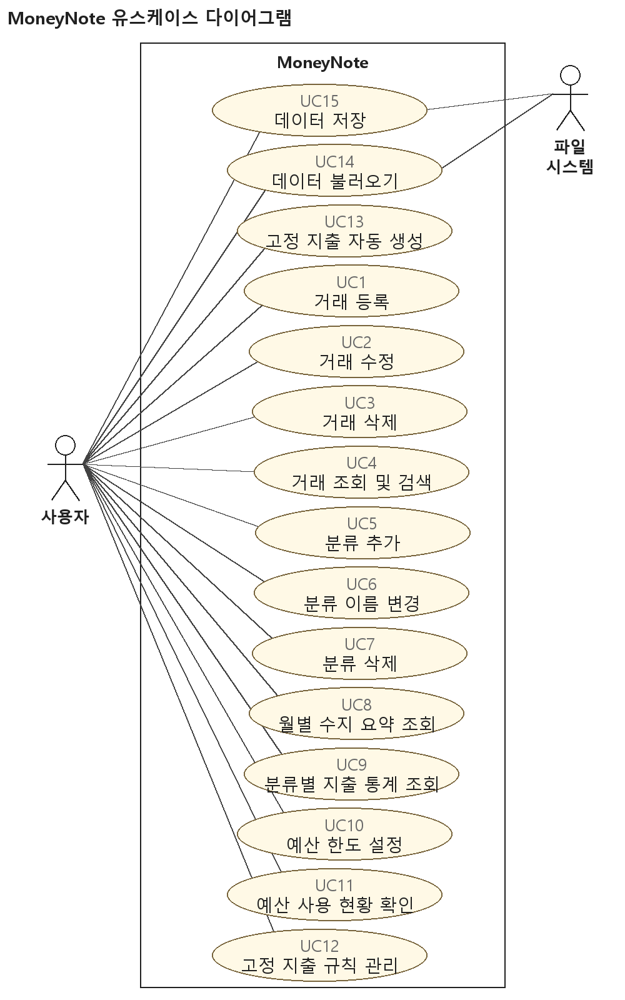

## Sequence Diagram

시퀀스 다이어그램 7개로 유스케이스의 진행을 객체와 메시지로 나타냈다. 객체 이름과 메시지는 소스 코드의 클래스와 메서드 이름을 쓰고, 인자가 긴 메시지는 (...)로 줄였다.

Fig. 2 는 거래 등록(UC1)이다. 입력 창은 날짜와 금액의 형식만 변환하고, 검증은 LedgerService.validate() 가 맡는다. 저장이 끝나면 TransactionPanel 이 목록을 다시 그리고 onDataChanged 로 통계·예산 화면에 알린다. 거래 수정(UC2)은 register 대신 update 를 부르는 것만 다르다.

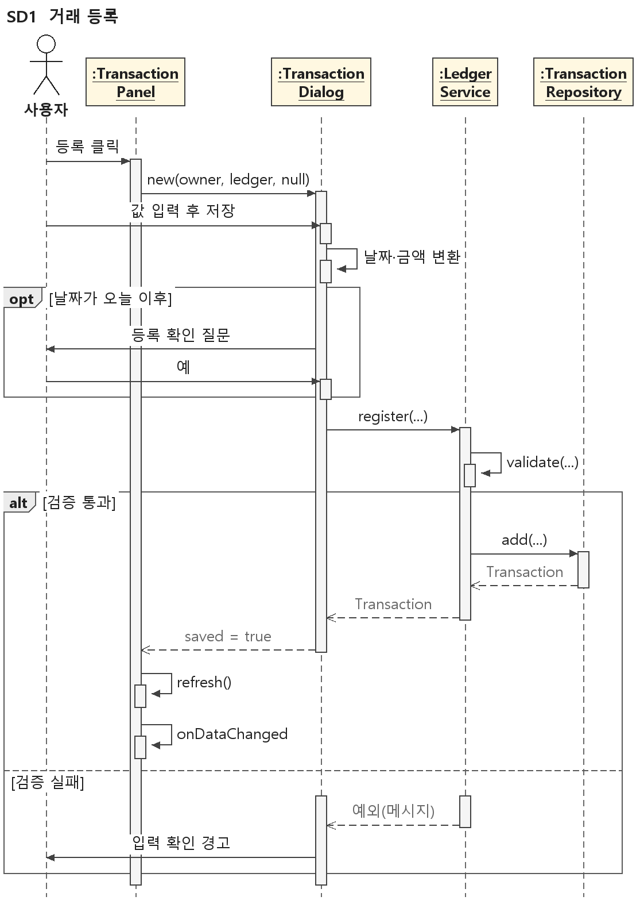

Fig. 3 은 거래 조회 및 검색(UC4)이다. 화면이 입력 조건으로 TransactionFilter 를 만들고, LedgerService.find() 가 조건 일치 검사와 날짜 내림차순 정렬을 맡는다.

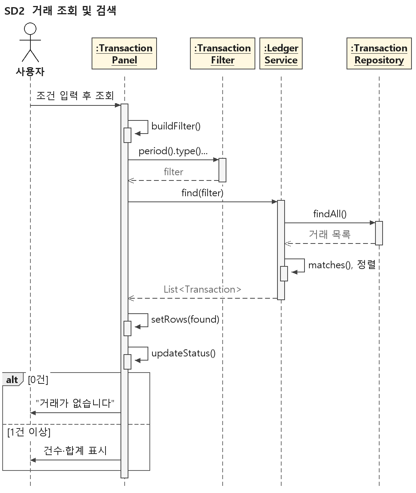

Fig. 4 는 분류 삭제(UC7)다. 삭제 전에 countByCategory() 로 사용 건수를 세어, 사용 중이면 예외로 막아 고아 거래가 생기지 않게 한다. 분류 추가와 이름 변경(UC5, UC6)도 같은 객체 사이에서 중복을 검사한 뒤 저장한다.

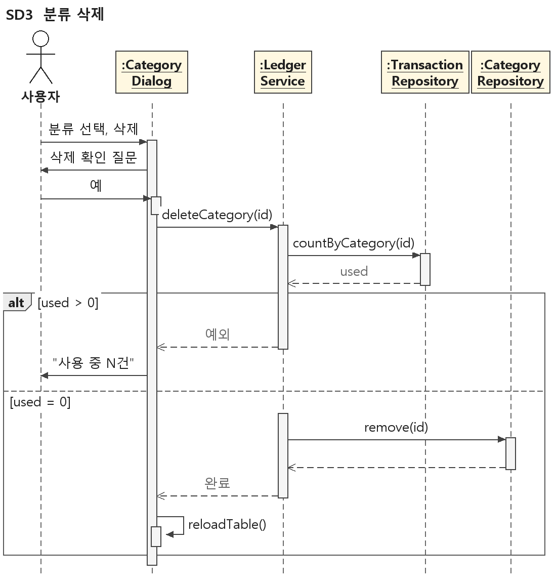

Fig. 5 는 수지 요약과 분류별 지출 통계(UC8, UC9)다. StatisticsService 가 거래 전체에서 그 달 값을 매번 다시 계산하므로 거래가 바뀌어도 합계가 어긋나지 않는다.

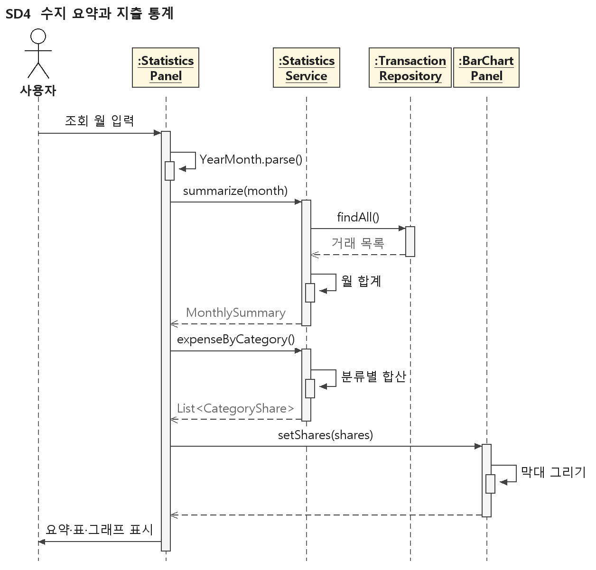

Fig. 6 은 예산 한도 설정과 현황 판정(UC10, UC11)이다. 한도 검증과 사용률 판정(levelOf)은 BudgetService 가, 분류별 사용액은 StatisticsService 가 계산한다.

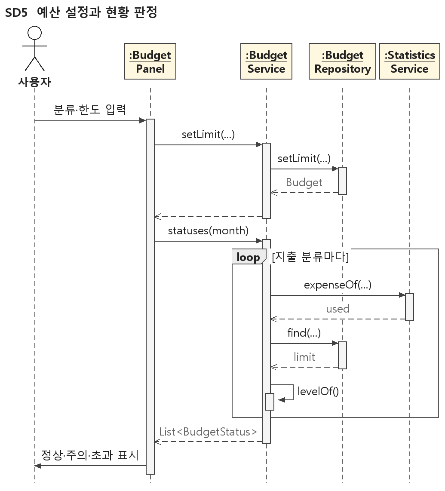

Fig. 7 은 프로그램 시작(UC14, UC13)이다. 저장소를 불러온 뒤 RecurringService.generateFor() 가 이번 달 고정 지출을 만들며, 생성은 LedgerService.register() 를 거쳐 UC1과 같은 검증을 받는다.

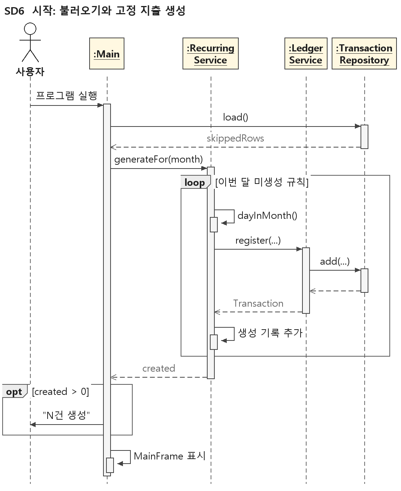

Fig. 8 은 프로그램 종료(UC15)다. 모든 저장소를 CSV로 쓰고, 쓰기에 실패하면 저장 없이 종료할지 물어 종료를 보류할 수 있게 한다.

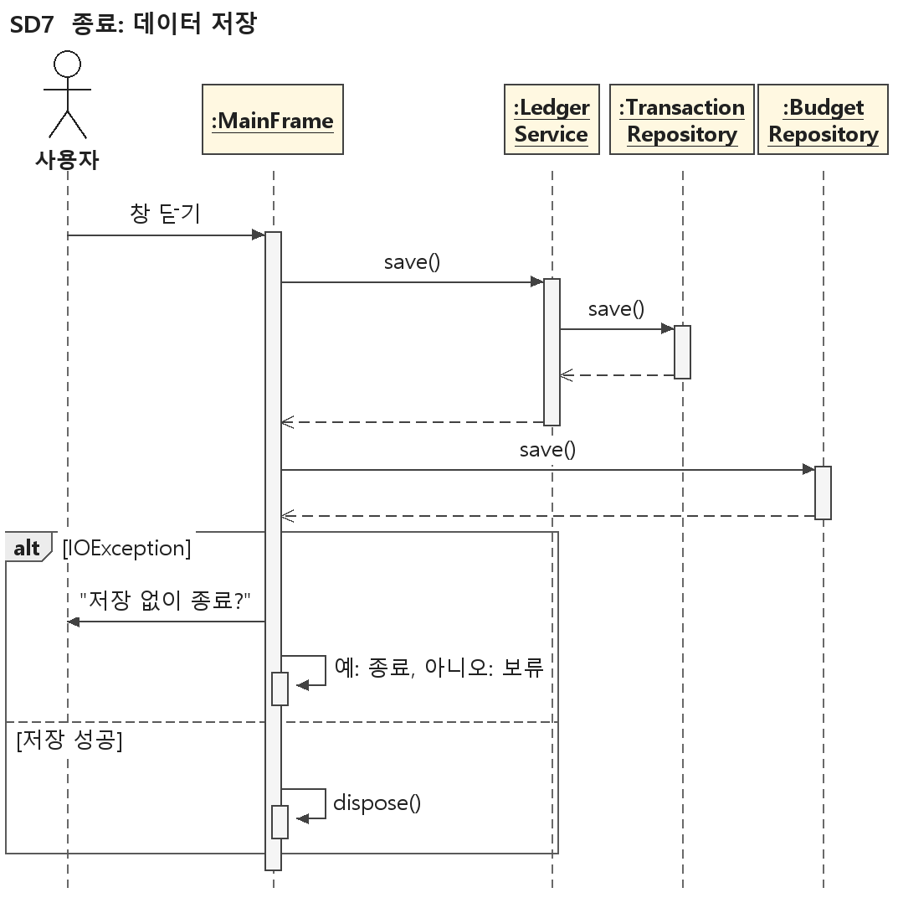

## User Interface Designs

화면은 Swing 으로 만든다. 메인 창 하나에 거래내역·통계·예산 탭을 두고, 입력과 관리 화면은 모달 대화상자로 연다. Fig. 9~12 는 구현된 화면을 예시 데이터로 그린 것이고, Fig. 13~14 는 이번에 새로 설계한 화면이다. 그림의 빨간 번호는 아래 설명의 번호와 같다.

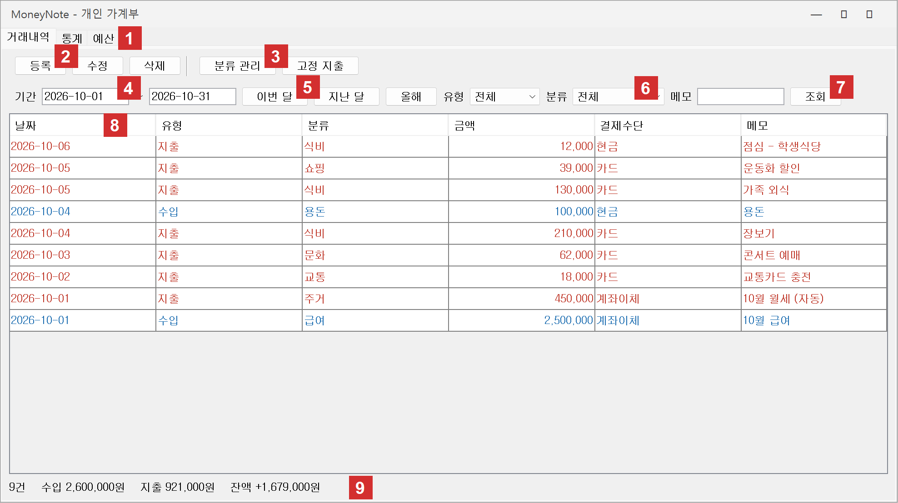

- 거래내역 탭 (UC1~UC4): ① 거래내역·통계·예산 탭 전환. ② 등록, 수정, 삭제 버튼. ③ 분류 관리, 고정 지출 버튼으로 Fig. 13, 14 의 창을 연다. ④ 기간 시작일~종료일. ⑤ 이번 달, 지난 달, 올해 버튼. ⑥ 유형·분류 필터와 메모 키워드. ⑦ 조회 버튼. ⑧ 거래 표, 지출은 빨강·수입은 파랑이며 헤더를 누르면 정렬된다. ⑨ 결과의 건수, 수입, 지출, 잔액.

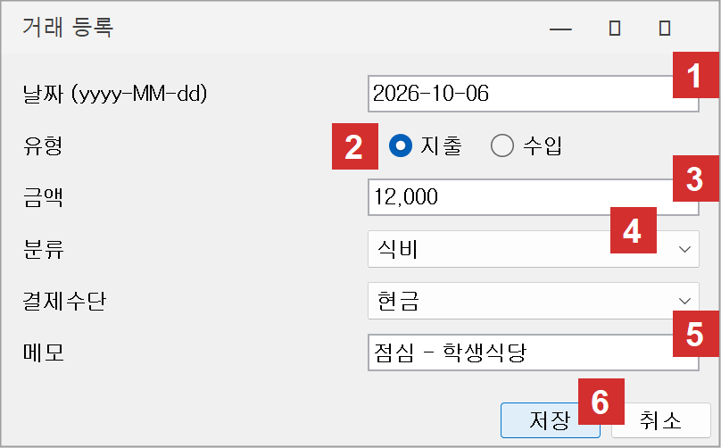

- 거래 등록·수정 대화상자 (UC1, UC2): ① 날짜, 등록이면 오늘로 채운다. ② 지출/수입 선택, 바꾸면 ④의 분류 목록이 바뀐다. ③ 금액, 쉼표를 허용한다. ④ 분류. ⑤ 메모. ⑥ 저장(Enter)과 취소. 수정이면 제목이 "거래 수정"이 되고 기존 값이 채워진다.

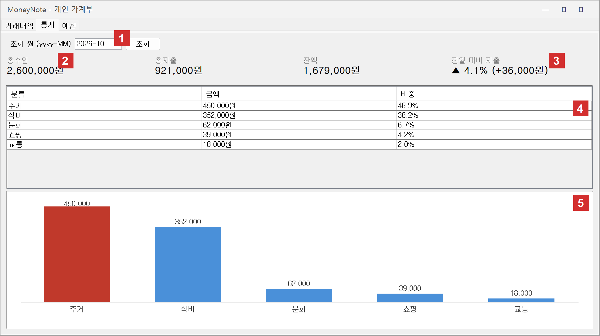

- 통계 탭 (UC8, UC9): ① 조회 월(yyyy-MM)과 조회 버튼. ② 총수입, 총지출, 잔액, 잔액이 음수면 빨간색. ③ 전월 대비 지출 증감률과 증감액. ④ 분류별 금액과 비중 표. ⑤ 막대그래프, 가장 큰 분류는 빨간 막대.

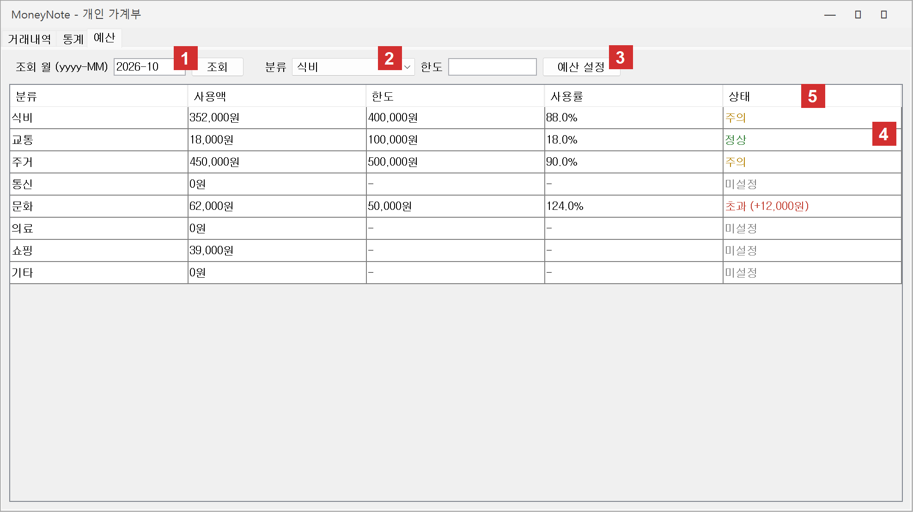

- 예산 탭 (UC10, UC11): ① 조회 월. ② 지출 분류 선택. ③ 한도 입력과 예산 설정 버튼. ④ 분류별 사용액, 한도, 사용률 표. ⑤ 상태: 정상(초록), 주의(노랑), 초과(빨강, 초과 금액 포함), 미설정(회색).

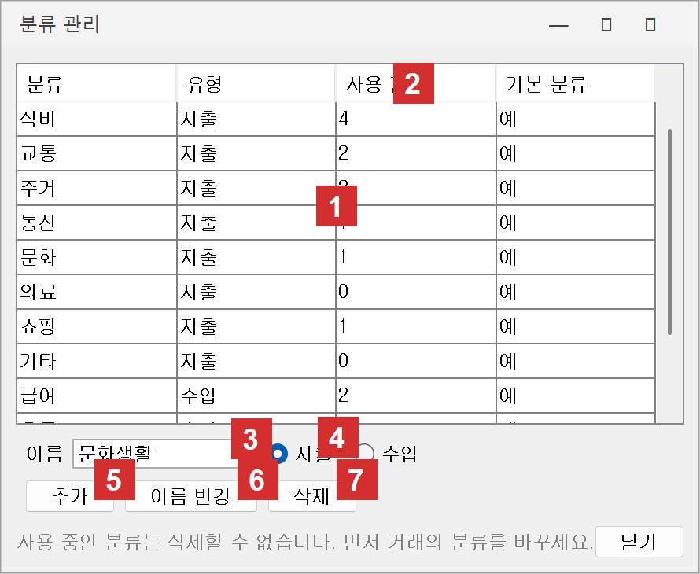

- 분류 관리 대화상자 (UC5~UC7, 설계): ① 분류 목록. ② 사용 건수 열로 삭제 가능 여부를 미리 보인다. ③ 이름 입력. ④ 유형 선택. ⑤ 추가. ⑥ 고른 분류의 이름을 ③의 값으로 바꾼다. ⑦ 삭제, 사용 건수가 0일 때만 성공한다.

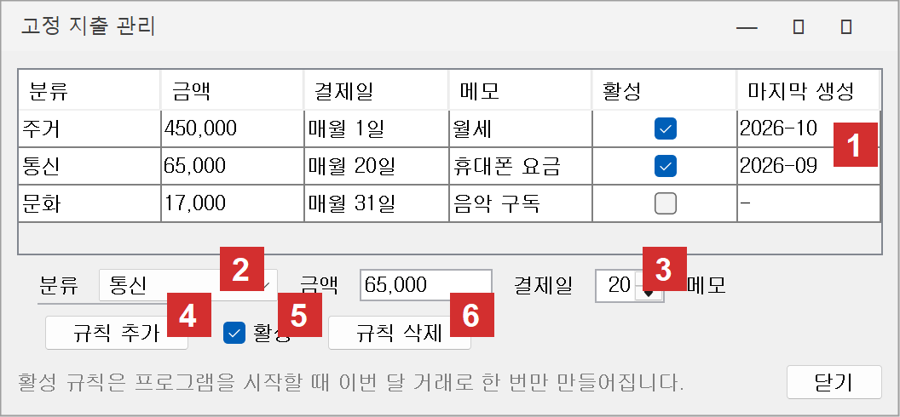

- 고정 지출 관리 대화상자 (UC12, 설계): ① 규칙 목록, 마지막 생성 월로 이번 달 생성 여부를 보인다. ② 지출 분류. ③ 매월 결제일(1~31). ④ 규칙 추가. ⑤ 활성 켜기·끄기. ⑥ 규칙 삭제.

## Function Specification

유스케이스 다이어그램과 시퀀스 다이어그램에서 서비스 계층의 핵심 함수 6개를 뽑았다. 화면은 이 함수만 부르고, 검증에 실패하면 함수가 예외를 던져 화면이 그 메시지를 보인다.

- Transaction  register(LocalDate date, TransactionType type, long amount, int categoryId, String payment, String memo)
> : LedgerService 의 함수. 입력은 날짜, 유형, 금액(원), 분류 id, 결제수단, 메모이고 출력은 새 id가 붙은 거래다. 날짜·유형이 있는지, 금액이 0보다 큰지, 분류가 있고 그 유형이 거래 유형과 같은지 검사한 뒤 저장소에 추가한다. 실패하면 IllegalArgumentException 을 던진다. (UC1, UC2, UC13 / Fig. 2, Fig. 7)
- List<Transaction>  find(TransactionFilter filter)
> : LedgerService 의 함수. 입력은 기간, 유형, 분류 id, 메모 키워드를 담은 조건이고 출력은 조건을 모두 만족하는 거래 목록이다. 비어 있는 조건은 무시하고, 키워드는 대소문자를 구분하지 않으며, 결과는 날짜 내림차순(같은 날은 id 내림차순)으로 정렬한다. (UC4 / Fig. 3)
- void  deleteCategory(int categoryId)
> : LedgerService 의 함수. 입력은 분류 id이고 출력은 없다. 이 분류를 쓰는 거래 수를 세어 0건일 때만 분류를 지운다. 사용 중이면 "이 분류를 사용하는 거래가 N건 있습니다." 메시지로 IllegalStateException 을 던진다. (UC7 / Fig. 4)
- List<CategoryShare>  expenseByCategory(YearMonth month)
> : StatisticsService 의 함수. 입력은 조회 월이고 출력은 (분류, 금액, 비중%) 목록이다. 그 달 지출을 분류별로 합산해 전체 대비 비중을 구하고 금액 내림차순으로 정렬하며, 상위 8개를 넘는 분류는 "기타"로 합친다. 지출이 없으면 빈 목록이다. (UC9 / Fig. 5)
- List<BudgetStatus>  statuses(YearMonth month)
> : BudgetService 의 함수. 입력은 조회 월이고 출력은 지출 분류마다 (사용액, 한도, 사용률, 단계)다. 사용액은 StatisticsService.expenseOf() 로, 한도는 예산 저장소에서 얻어 사용률 80% 미만은 정상, 80% 이상 100% 미만은 주의, 100% 이상은 초과, 한도가 없으면 미설정으로 판정한다. (UC10, UC11 / Fig. 6)
- List<Transaction>  generateFor(YearMonth month)
> : RecurringService 의 함수. 입력은 생성할 달이고 출력은 이번 호출에서 만든 거래 목록이다. 활성 규칙 중 "규칙 id@연월" 생성 기록이 없는 것마다 결제일로 날짜를 정해(없는 날은 말일) register() 로 지출 거래를 만들고 생성 기록을 남긴다. 생성 기록은 규칙과 함께 CSV에 저장해 재실행이나 사용자 삭제 뒤에도 중복 생성하지 않는다. (UC13 / Fig. 7)
